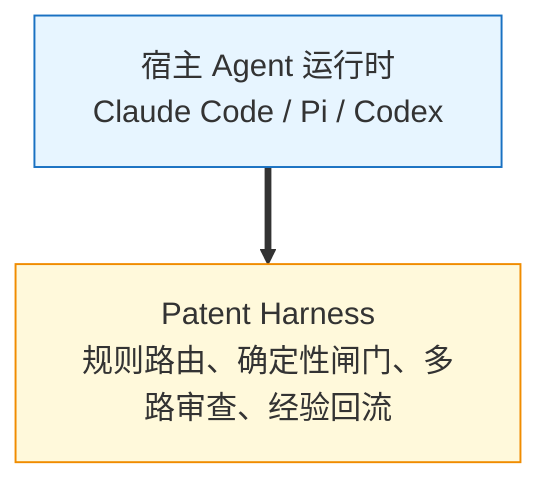
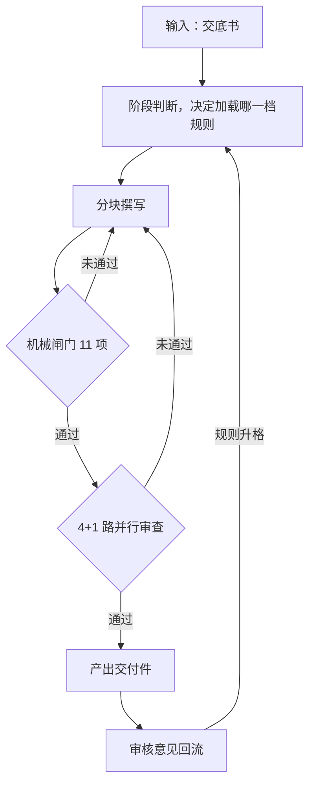
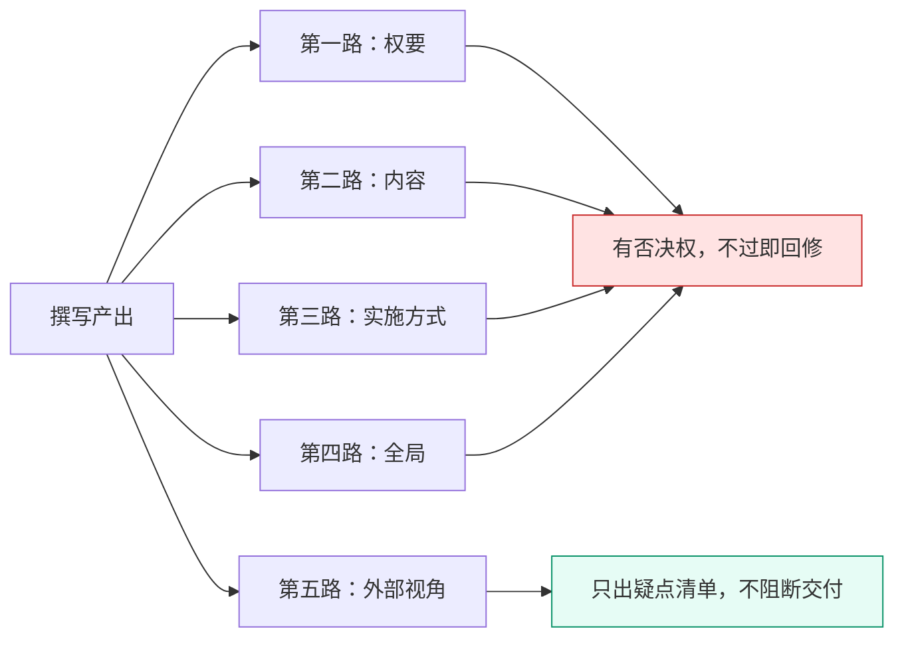
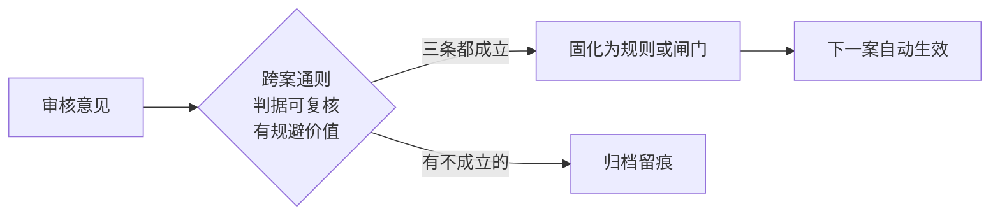

<div align="center">

# Patent Harness

**专利撰写场景的领域编排层**

把高约束专业文档的生成，组织成一条带多重质检的工作流。

[](https://www.python.org/)
[]()
[]()

[它是什么](#它是什么) ·
[工作流](#工作流) ·
[核心机制](#核心机制) ·
[快速开始](#快速开始) ·
[设计取舍](#设计取舍) ·
[量化](#量化)

</div>

---

## 它是什么

跑在 Agent 运行时之上的一层领域编排。模型调用、工具循环、文件访问由宿主负责（Claude Code、Pi、Codex 都可以）；这一层负责专业领域内的部分：按阶段加载规则、跑确定性校验、编排多路审查、把审核意见固化成检查项。



换一个专业领域，要换的是规则库和模板资产，编排骨架不用动。

---

## 它解决什么问题

专业文档撰写有一套很庞大的规范，成体系的规范可以到十几万字。这给生成过程带来三个麻烦。

**规范读不完。** 全量喂进上下文，token 花得多，判断质量反而下降。可漏读一条就可能返工。

**错一处会传染。** 编号、术语、引用基础、公式里的参数量和量纲，一处错会带着下游整段错，而模型自己审不出来。

**有些判断模型做不了。** 格式、结构、数值自洽可以写成代码；方案合不合理、符不符合行业惯例，写不成代码。这两类得走不同通道。

---

## 工作流



机械闸门只判能写成代码的部分，模型审查只判写不成代码的部分。闸门不过，审查不启动。

---

## 核心机制

### 任务规划与流程编排

用 sha1 指纹锁冻结上游产物。分阶段模式下，上游定稿后把指纹写进下游文档头部，撰写期间上游一改就硬停并要求重新同步，避免上游改动导致下游整段返工。另有一条直写路径不冻结，一轮写完整篇。

### 工具调用与确定性校验

27 个校验脚本，按职责分成六层：

| 层 | 判什么 |
|---|---|
| 规则硬约束 | 格式、结构、措辞、数值自洽 |
| 跨块结构 | 主步骤同构、编号连续、依赖合法 |
| 上下游对齐 | 引用基础、特征差集、术语一致 |
| 公式健康 | 空壳公式、编号残留、字体异常 |
| 文档骨架 | 分节、页眉、可见性、标题格式 |
| 版本时序 | 下游早于上游的版本倒挂 |

交付前固定跑 11 项闸门，任一项不过就阻断回修。机械类错误不靠模型兜底。

### 上下文工程与知识路由

规则分三档加载：

| 档 | 何时加载 |
|---|---|
| 必读核心 | 该阶段每次都加载 |
| 触发式按需 | 命中触发条件才加载 |
| 禁止默认读取 | 明确列出不该读的 |

规则不整篇读入，按标题切出需要的那一节。切的位置另有脚本核对，防止切空之后静默返回空结果。

### 多 Agent 协作

审查分 4+1 路。



前四路用本项目的规则做一致性检查，各读各的规则包，有否决权。第五路禁止读取本项目规则库，用领域常识做正确性检查，只出疑点清单，不阻断交付。

分两路的意义在于判据来源不同。一个内部完全自洽的方案，可以整体不合常理。实测里，数值量级错误、算式本身算错这类硬伤只被第五路抓到过。

各路互不共享假设，也不互看报告，结论由主 agent 汇总成回修清单逐条裁决。

### 任务降级与兜底

编排有三条降级路径：并行编排、逐路派发、主 agent 串行。累计三次失败就切到串行并锁定，避免工具不可用时整个任务卡死。降级按路隔离，失败的那一路不影响其余；每次降级都写进报告首行，不静默。

### 经验沉淀与规则治理

每次交付后写一份复盘，把审核意见逐条过准入闸，判断能不能进规则库。



进规则要同时满足三条：是跨案通则、判据可复核、不写下来下次还会犯。三条不齐的只归档，不为凑完整度强行升格。

规则库本身也要治理膨胀。同节的具名条设上限，必读文件设行数软上限，各阶段读取量留基线，超基线 10% 就触发一次「这条规则该不该进必读层」的审查。

---

## 快速开始

```bash
# 1. 环境自检（Python 依赖、外部工具、插件）
python scripts/check_env.py --json

# 2. 补齐 pip 侧依赖
python scripts/check_env.py --fix

# 3. 跑测试
python -m pytest tests/ -q
```

依赖 Python 3.10+。可选 `pandoc`，用来把公式转成原生 OMML；缺失时公式回退为纯文本，不阻断工作。

回归装置需要指向本地案卷目录，没设就自动跳过：

```bash
export PATENT_CASES_DIR=/path/to/cases   # Windows: set PATENT_CASES_DIR=...
```

---

## 目录结构

```
SKILL.md              工作流定义（阶段、闸门、验收标准）
rules.md              规则索引（阶段读取表、编号体系、维护纪律）
agents/               6 个审查路契约，每路独立判据、独立可见面
scripts/              27 个确定性校验与处理脚本
references/rules/     17 个规则文件，按阶段分档，渐进式加载
references/cases/     执行层标准与范例
assets/docx/          文档模板资产
tests/                单元测试与回归装置
docs/                 安装、维护记录、规则读取流程
```

---

## 设计取舍

<details>
<summary>为什么机械判定优先于模型判定</summary>

能写成脚本的不交给模型。模型判断有抖动，成本高，也没法在 CI 里复现。脚本是毫秒级、免费、稳定的。模型只处理代码搞不定但能用结构化描述的部分。

</details>

<details>
<summary>为什么第五路禁止读自家规则库</summary>

读了就成了用我们的标准审我们的稿，跟它存在的理由相冲突。它要提供的是不共享假设的第二意见。实测也确认两者不能互相替代：前三路全部通过之后，第五路仍然抓到过完全没被命中过的问题。

</details>

<details>
<summary>为什么模板句要建唯一副本</summary>

格式和套话不交给模型自由发挥。模板句集中在一处渲染，整句粘贴只填槽位，再做 Markdown 和 DOCX 两层逐字校验。能固定下来的就用脚本或填空模板固定，不以文本规则的形式交给 LLM。

</details>

<details>
<summary>为什么规则库要治理膨胀</summary>

规则越多，每次加载的上下文越贵，判断质量反而下降。所以设了三道限：同节条数上限、单文件行数软上限、阶段读取量预算。规则升格另有一道准入闸，不为凑完整度强行升格。

</details>

---

## 量化

| 项 | 值 |
|---|---|
| 确定性校验脚本 | 27 个 / 10,520 行 |
| 规则文件 | 17 个 / 1,652 行 |
| Agent 契约 | 6 个 |
| 测试 | 2,932 行 / 116 个用例 |
| 回归装置 | 4 个 |
| 交付前必跑闸门 | 11 项 |
| 代码总量 | 13,452 行 |

---

## 落地

已在 4 人撰写团队日常使用，累计产出 40 篇以上专业申请文件，持续迭代中。

每次交付后做一次复盘：审核意见过准入闸，能机械判定的固化成闸门，判不了的才留作文本规则。规则库随案件增长而不膨胀。

---

<div align="center">

License: 内部项目，暂未设定许可证

</div>
