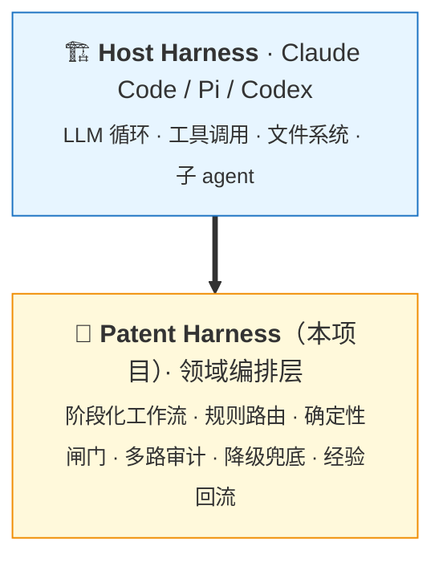
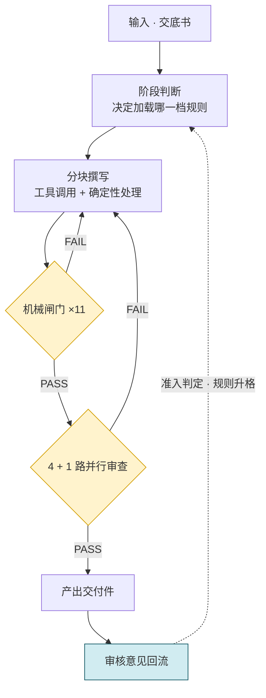
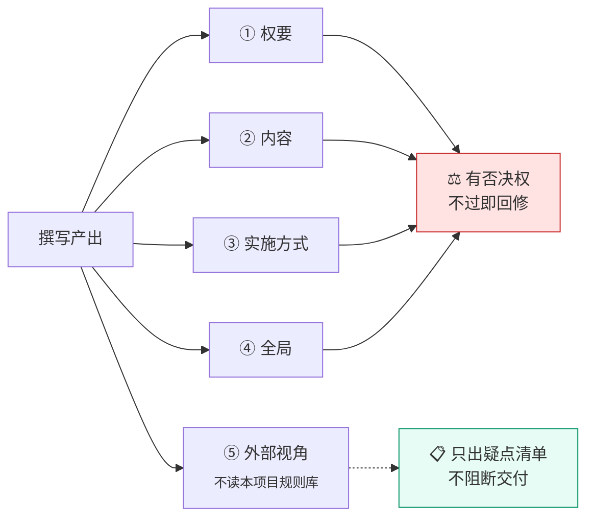
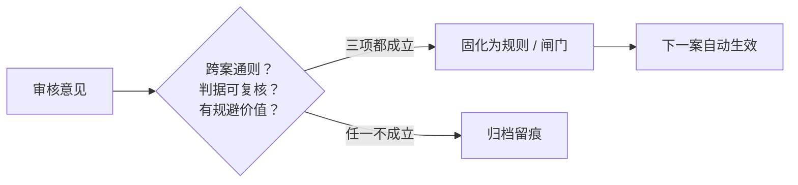

<div align="center">

# Patent Harness

**面向长流程专业写作的领域 Harness**

把高约束专业文档的生成，编排成一条带多重质检的工作流。

[](https://www.python.org/)
[]()
[]()
[]()

[它是什么](#它是什么) ·
[工作流](#工作流) ·
[核心机制](#核心机制) ·
[快速开始](#快速开始) ·
[设计取舍](#设计取舍) ·
[量化](#量化)

</div>

---

## 它是什么

一个跑在现有 Agent 运行时之上的**领域编排层**——不自带 LLM 循环，专注做规则路由、确定性闸门、多路审计编排与经验回流。



编排层与领域规则库**分离**：换一个专业领域，置换的是规则库与模板资产，编排骨架不变。

---

## 它解决什么问题

高约束专业文档（权利要求书、说明书、检索报告……）的生成，难点不在"写不出来"：

<table>
<tr><td width="33%" valign="top">

**📚 约束量远超上下文预算**

一个成体系的撰写规范可以到十几万字。全量喂给模型既贵又降低判断质量；但漏读一条就可能返工。

</td><td width="33%" valign="top">

**🔗 机械错误污染下游**

编号、术语、引用基础、公式参数量纲——错一处，下游整段跟着错，而模型自己审不出来。

</td><td width="33%" valign="top">

**⚖️ 质量判断不能全交给模型**

"规则能判的"和"规则判不了的"必须走不同通道、用不同判据。

</td></tr>
</table>

---

## 工作流



**两次质检的分工**：机械闸门只判"能写成代码的"，模型审查只判"代码搞不定但能结构化描述的"。**前者不过，后者不启动。**

---

## 核心机制

### 1️⃣ 任务规划与流程编排（Plan-and-Execute）

用 **sha1 指纹锁**实现上游产物冻结。分阶段模式下，上游定稿后被钉进下游文档头部，下游撰写期间一旦变动就**硬停**并要求重新同步——避免"上游一改、下游整段返工"。另有直写模式不冻结，一轮写完整篇。

### 2️⃣ 工具调用与确定性校验

**27 个确定性校验脚本（10,520 行）**，按职责分层：

| 层 | 判什么 |
|---|---|
| 规则硬约束 | 格式、结构、措辞、数值自洽 |
| 跨块结构 | 主步骤同构、编号连续、依赖合法 |
| 上下游对齐 | 引用基础、特征差集、术语一致 |
| 公式健康 | 空壳公式、编号残留、字体异常 |
| 文档骨架 | 分节、页眉、可见性、标题格式 |
| 版本时序 | 下游早于上游的版本倒挂 |

交付前固定跑 **11 项闸门**，任一不过即阻断回修。**机械错误不靠模型兜底。**

### 3️⃣ 上下文工程与知识路由

**三档渐进式披露**：

| 档 | 何时加载 |
|---|---|
| 🟢 必读核心 | 该阶段每次都加载 |
| 🟡 触发式按需 | 命中触发条件才加载 |
| 🔴 禁止默认读取 | 明确列出不该读的 |

规则不整篇读入，按标题切出所需那节；**切的位置另有校验脚本核对**，防止切空后静默返回空结果。

### 4️⃣ 多 Agent 协作（Multi-Agent）

**4 + 1 路并行审查**：



第 5 路的存在理由是**判据来源不同**：

> 前 4 路用本项目标准做**一致性检查**；第 5 路用**领域常识**做正确性检查。
> 一个内部完全自洽的方案，可以整体不合常理。

实测中，数值量级错误、算式本身算错这类硬伤**只被第 5 路抓到过**。各路互不共享假设、也不互看报告。

### 5️⃣ 任务降级与兜底

**三级降级链**：并行编排 → 逐路派发 → 主 agent 串行。累计 3 次失败自动切换并锁死，避免工具不可用时任务整体卡死。

降级**按路隔离**——失败那一路不影响其余；每次降级写进报告首行。**工具环境再差也不中断主流程，但降级不静默。**

### 6️⃣ 经验沉淀与规则治理

每次交付后产出复盘，把审核意见按**准入闸**逐条判定是否升格进规则库：



同时治理规则库自身的膨胀：同节具名条设上限、必读文件设软上限、各阶段读取量留基线（**超基线 10% 触发一次"这条规则该不该进必读层"的审查**）。

---

## 快速开始

```bash
# 1️⃣ 环境自检（检查 Python 依赖、外部工具、插件）
python scripts/check_env.py --json

# 2️⃣ 补齐 pip 侧依赖
python scripts/check_env.py --fix

# 3️⃣ 跑测试
python -m pytest tests/ -q
```

> **依赖**：Python 3.10+。可选 `pandoc`（把公式转为原生 OMML；缺失时公式回退为纯文本，不阻断工作）。
>
> **回归装置**（可选）：需指向本地案卷目录，未设置则自动跳过。
> ```bash
> export PATENT_CASES_DIR=/path/to/cases   # Windows: set PATENT_CASES_DIR=...
> ```

---

## 目录结构

```
SKILL.md              工作流定义（阶段、闸门、验收标准）
rules.md              规则索引（阶段读取表、编号体系、维护纪律）
agents/               6 个审查路契约 — 每路独立判据、独立可见面
scripts/              27 个确定性校验与处理脚本
references/rules/     17 个规则文件，按阶段分档，渐进式加载
references/cases/     执行层标准与范例
assets/docx/          文档模板资产
tests/                单元测试 + 回归装置
docs/                 安装、维护记录、规则读取流程
```

---

## 设计取舍

<details>
<summary><b>为什么机械判定优先于模型判定</b></summary>

能写成脚本的绝不交给模型。模型的判断有抖动、成本高、且无法在 CI 里复现；脚本判定毫秒级、免费、100% 稳定。模型只用来处理"代码搞不定但能结构化描述"的部分。

</details>

<details>
<summary><b>为什么外部视角那一路禁止读自家规则库</b></summary>

一旦它读了本项目的规则，就变成了"用我们的标准审我们的稿"，与其存在理由（提供不共享假设的第二意见）相悖。实测确认两者不可互相替代：三路全部 PASS 之后，第 5 路仍能抓出完全未被命中的可实施性问题。

</details>

<details>
<summary><b>为什么模板句要建唯一副本</b></summary>

格式与套话类问题不交给模型自由发挥：模板句集中在一处渲染、整句粘贴只填槽位，再做双层逐字校验。**能固定下来的就用脚本或填空模板固定，不以文本规则的形式交给 LLM。**

</details>

<details>
<summary><b>为什么规则库要治理膨胀</b></summary>

规则越多，每次加载的上下文越贵、判断质量反而下降。所以设了三道限：同节条数上限、单文件行数软上限、阶段读取量预算。规则升格还有一道准入闸——**不为凑完整度强行升格**。

</details>

---

## 量化

<table>
<tr><td width="50%" valign="top">

| 项 | 值 |
|---|---|
| 确定性校验脚本 | **27 个** / 10,520 行 |
| 规则文件 | **17 个** / 1,652 行 |
| Agent 契约 | **6 个** |
| 测试 | 2,932 行 / **116 个用例** |
| 回归装置 | **4 个** |
| 交付前必跑闸门 | **11 项** |
| 代码总量 | **13,452 行** |

</td><td width="50%" valign="top">

**运行方式**

- 编排层与 Host Harness 解耦
- 规则按阶段热加载，不整篇读入
- 闸门可独立执行（纯脚本，无需模型）
- 回归装置用已定稿的真实案件做端到端比对

**治理机制**

- 同节具名条上限
- 必读文件行数软上限
- 阶段读取量预算（超基线 10% 触发审查）
- 三级降级链（累计 3 次失败切换）

</td></tr>
</table>

---

## 落地

已在 **4 人撰写团队**日常使用，累计产出 **40 篇以上**专业申请文件，持续迭代中。

每次交付后做一次复盘：审核意见 → 准入判定 → 固化成规则或机械闸门。**能机械判定的直接固化成闸门，判不了的才留作文本规则**——规则库随案件增长而不膨胀。

---

<div align="center">

**License** · 内部项目，暂未设定许可证

</div>
