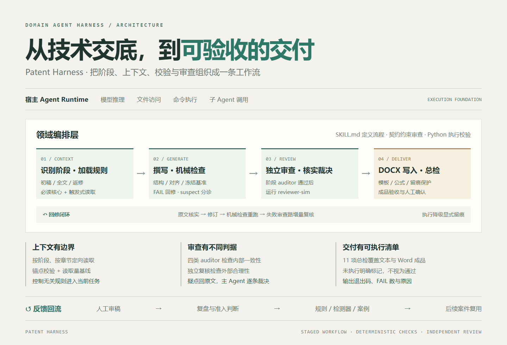
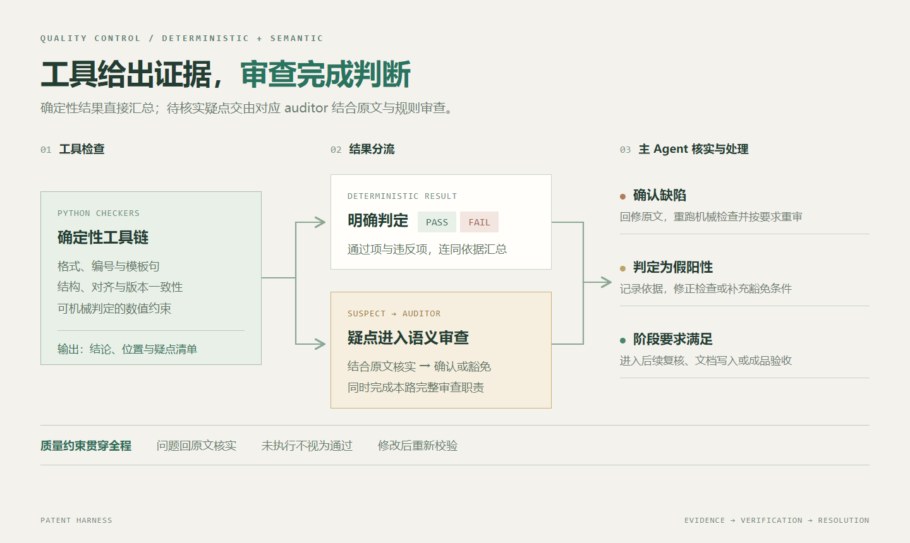
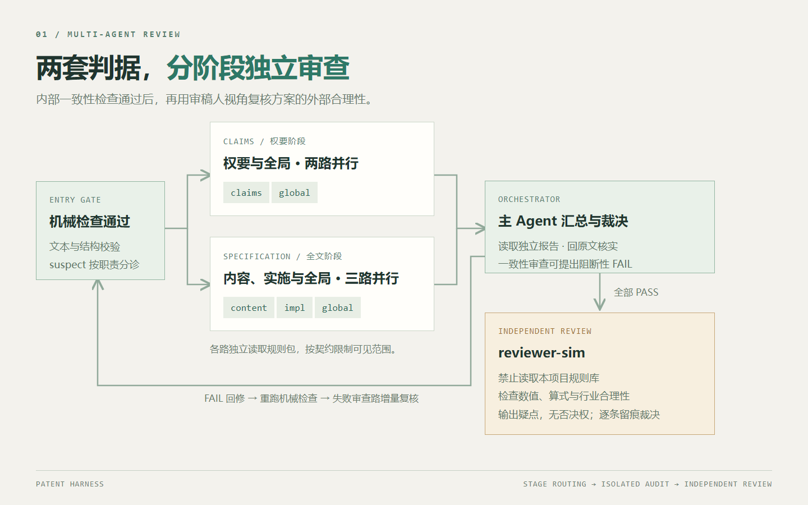
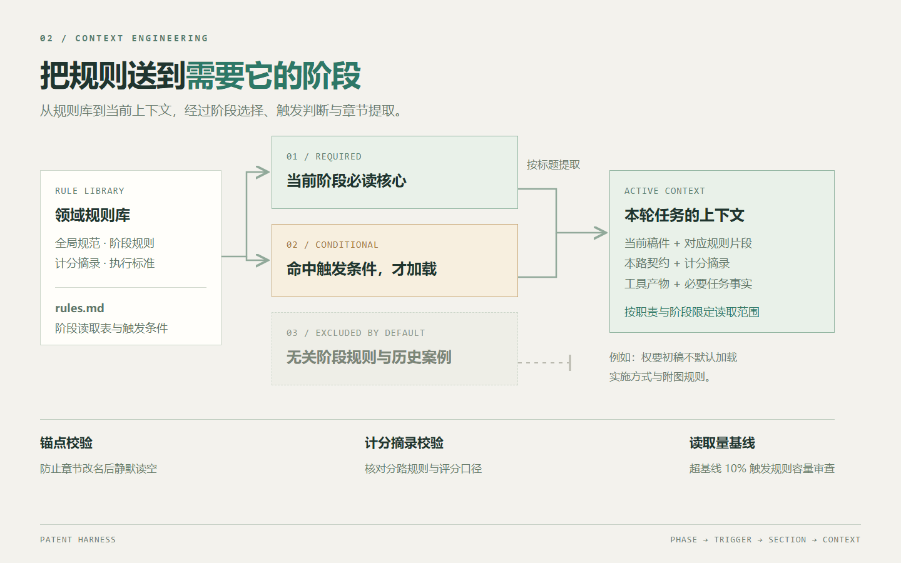
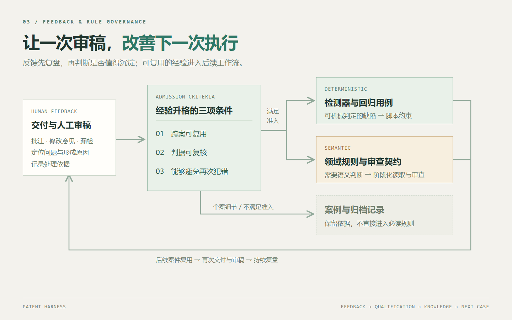

<div align="center">

# Patent Harness

### 专利撰写多 Agent 编排框架

把交底书、领域规则、工具校验与人工反馈，组织成可重复执行的专业文档工作流。


**阶段化编排 · 确定性校验 · 独立语义审查 · DOCX 交付 · 反馈回流**

[项目概述](#项目概述) · [系统架构](#系统架构) · [设计亮点](#设计亮点) · [工作流](#工作流) · [快速开始](#快速开始) · [源码导航](#源码导航)

</div>



## 项目概述

Patent Harness 是运行于 **Agent Runtime 之上的领域编排层**，面向专利申请文件这类高约束、长流程、多轮返修的文档任务。它将任务识别、阶段化上下文加载、工具调用、确定性校验、多 Agent 审查和经验沉淀整合到一套工作流中，覆盖从交底书理解到 Word 交付的完整过程。

宿主提供模型调用、文件访问、命令执行与子 Agent 能力；本项目通过 **阶段化工作流、审查契约、Python 工具链和领域规则库**，定义每个阶段应读取什么、执行什么、如何验收，以及失败后如何继续。

项目已在 **4 人撰写团队**的日常工作中使用，团队累计产出 **40 篇以上专利申请文件**，持续根据真实审稿反馈迭代。

### 要解决的问题

| 业务难点 | 工程设计 | 对应能力 |
|---|---|---|
| 规则多，全文加载容易混入无关阶段要求 | 按阶段与触发条件选择规则，按章节定向读取 | Context Routing |
| 权要、说明书、公式与 Word 成品容易出现跨文件偏差 | 结构检查、指纹锁、时序守卫、注入后校验 | 确定性工具链 |
| 自查容易沿用生成时的假设 | 按职责隔离 auditor，并增加不同判据来源的复核 | Multi-Agent 审查 |
| 返修可能破坏已定稿内容或已有修订 | 冻结基准、增量复核、OOXML 最小侵入式写入 | 文档一致性与留痕 |
| 审稿经验停留在聊天中，下个案件重复踩坑 | 反馈分诊，沉淀为规则、检测器或案例 | 反馈回流与规则治理 |

## 系统架构

项目采用“**宿主执行能力 + 领域工作流 + 确定性工具**”的分层方式。编排策略由 Markdown 工作流与契约描述，由宿主 Agent 执行；Python 脚本承担可机械判定、可重复验证的部分。

| 层次 | 职责 | 实现入口 |
|---|---|---|
| 宿主运行时 | 模型推理、文件与命令工具、子 Agent 调用 | 当前工作流包含 `Workflow` / `Agent` 调用约定 |
| 领域编排 | 阶段识别、执行顺序、回修重审、降级与交付验收 | [`SKILL.md`](SKILL.md) |
| 上下文路由 | 必读核心、触发式规则、禁止默认读取项 | [`rules.md`](rules.md)、[`references/rules/`](references/rules/) |
| 语义审查 | 四类一致性 auditor 与两份审稿人视角契约 | [`agents/`](agents/) |
| 确定性执行 | 文本校验、跨块对齐、版本守卫、DOCX 处理 | [`scripts/`](scripts/) |
| 资产与反馈 | 文档模板、执行经验、维护记录、回归装置 | [`assets/`](assets/)、[`references/cases/`](references/cases/)、[`tests/`](tests/) |

接入其他 Agent Runtime 时，需要映射其工具接口、子 Agent 能力与 DOCX 执行能力。规则和工具可复用，宿主侧调用约定仍需适配。

## 设计亮点

### 1. 多阶段编排：让任务有明确的状态与验收点

工作流区分权要初稿、权要返修、全文初稿、全文返修和直写全文，分别约束输入、规则读取范围、审查路径与交付物。

- **分阶段撰写**：权要定稿后建立冻结基准，说明书围绕该基准展开。
- **直写全文**：一轮组织权要与全文撰写，保留各自的审查节点，最终交付全文稿。
- **返修与增量复核**：机械检查重新执行；上轮存在 FAIL 的审查路携带失败项与改动块重审，完整性类检查仍按契约全量执行。

跨文件状态用工具守护：[`fingerprint_claims.py`](scripts/fingerprint_claims.py) 检查冻结权要的 SHA-1 指纹，[`timestamp_guard.py`](scripts/timestamp_guard.py) 检查版本时序，避免上游改动后下游仍沿用旧基准。

### 2. 混合质量架构：确定性检查与语义判断各司其职



格式、结构、编号、模板句和部分数值约束由 Python 检查；技术合理性、解释是否充分、疑似缺陷是否成立交给模型审查。工具输出的 `suspect` 按职责进入对应 auditor，由其结合原文确认或给出豁免理由。

| 检查维度 | 代表实现 | 关注的问题 |
|---|---|---|
| 文本硬规则 | [`check_hard_rules.py`](scripts/check_hard_rules.py) | 格式、措辞、引用基础及硬约束 |
| 跨块结构 | [`check_cross_block.py`](scripts/check_cross_block.py) | 主步骤对应、编号与依赖关系 |
| 权要—说明书对齐 | [`verify_claims_alignment.py`](scripts/verify_claims_alignment.py) | 特征覆盖与跨文档一致性 |
| 预设内容 | [`check_preset_params.py`](scripts/check_preset_params.py) | 阈值、权重等预设量的说明完整性 |
| Word 成品 | [`verify_docx_skeleton.py`](scripts/verify_docx_skeleton.py)、[`verify_docx_injection.py`](scripts/verify_docx_injection.py) | 骨架、章节落位、格式与注入结果 |
| 公式与页数 | [`omml_formulas.py`](scripts/omml_formulas.py)、[`check_page_count.py`](scripts/check_page_count.py) | 公式健康与文档篇幅 |

[`run_gates.py`](scripts/run_gates.py) 将 **11 项交付总检**固化为可执行清单，输出“闸门 / 退出码 / FAIL 数 / 备注”。缺少输入或无法执行的项目明确标为“未执行”，避免漏跑被当成通过。

| 退出码 | 含义 |
|---|---|
| `0` | 全部执行且通过 |
| `1` | 存在闸门 FAIL |
| `2` | 无 FAIL，但存在未执行项 |

**11 项是交付总检清单，包含 DOCX 生成后的检查。** 撰写阶段先运行对应的文本检查，再进行语义审查；Word 写入完成后检查成品。

### 3. 多 Agent 审查：职责隔离、判据分离、主 Agent 裁决

项目定义 **四类 auditor + 审稿人视角复核**，共 6 份契约。审查路按阶段选择，第五路在前置检查通过后执行。



| 审查角色 | 判据来源 | 审查范围 | 决策边界 |
|---|---|---|---|
| `claims-auditor` | 本项目权要规则 | 权利要求结构、引用与表达 | 可提出阻断性 FAIL |
| `content-auditor` | 本项目发明内容规则 | 发明内容及相关章节 | 可提出阻断性 FAIL |
| `impl-auditor` | 本项目实施方式规则 | 具体实施方式与解释深度 | 可提出阻断性 FAIL |
| `global-auditor` | 本项目全局规则 | 跨块关系与全局一致性 | 可提出阻断性 FAIL |
| `reviewer-sim` | 审稿人视角契约与领域知识 | 外部合理性、数值量级、算式与行业惯例 | 输出疑点清单，无否决权 |

`reviewer-sim` 分为权要、说明书两份契约，**禁止读取本项目规则库**。这使复核可以质疑生成流程所沿用的假设：文本内部一致，仍可能存在方案层面的不合理。

各路以契约约束输入字段、工具白名单与可见范围，规则以文件路径传入；主 Agent 负责报告合并与最终裁决。任何一路报出的缺陷，都要回到原文核实。采纳第五路建议而改稿后，也要按回修规则重新检查。

### 4. 渐进式上下文路由：把读取范围作为工程约束



规则分成三档：**当前阶段必读、触发时读取、禁止默认读取**。例如，权要初稿不默认加载具体实施方式与附图规则；全文阶段以已冻结权要为基准，读取说明书相关规则。

审查路按章节标题定向提取自己的规则，并使用独立的 `scoring-*.md` 计分摘录。配套工具验证规则引用本身，防止规则改名后审查路静默读空。

- [`verify_rule_anchors.py`](scripts/verify_rule_anchors.py)：校验契约锚点与规则标题。
- [`verify_scoring_excerpts.py`](scripts/verify_scoring_excerpts.py)：校验分路计分摘录。
- [`rules_budget.py`](scripts/rules_budget.py)：统计阶段读取量，与基线比较。

规则治理设置同节具名条数量限制、必读文件行数软上限；读取量超过基线 **10%** 时触发审查，重新判断新增内容是否需要进入必读层。完整读取关系见[规则读取流程](docs/规则读取流程.md)。

### 5. 失败降级：工具不可用时仍有明确的执行路径

工作流约定优先使用 `Workflow` 编排，失败后切换为 `Agent` 逐路并行派发，再尝试一次 `Workflow`。累计 3 次编排失败后，切换为主 Agent 按契约串行审查，并在本次审查流程内锁定串行模式。

单路连续失败也可独立降级，其余路继续运行。**降级只改变执行方式，不免除机械闸门**；实际采用的方式必须在完工报告中写明。回修重审作为新流程重新尝试编排。

### 6. DOCX 执行与反馈回流：把质量约束延伸到交付之后

文档交付复用既有模板，检查分节、页眉、标题落位与公式。说明书公式通过 Pandoc 转换为原生 OMML；留痕返修采用直接编辑 OOXML 部件的最小侵入方式，保留已有批注和修订。

固定套话由 [`boilerplate.py`](scripts/boilerplate.py) 集中渲染，再对 Markdown 与 DOCX 做校验，减少生成文本与最终交付件之间的偏差。

交付后的人工反馈经过准入判断再沉淀：**跨案可复用、判据可复核、能够避免再次犯错**。能机械判定的进入检测器；需要语义判断的进入规则；个案细节保留为案例或归档记录。



## 工作流

| 场景 | 执行主线 | 交付重点 |
|---|---|---|
| 权要初稿 | 理解交底书 → 撰写权要 → 机械检查 → claims/global 审查 → 审稿人视角复核 | 权要稿与阶段基准 |
| 全文初稿 | 读取冻结权要 → 补全说明书 → 机械检查 → content/impl/global 审查 → 审稿人视角复核 | 全文 DOCX 与成品校验 |
| 直写全文 | 权要撰写及审查 → 全文撰写及审查 → Word 写入 | 一份全文交付稿 |
| 批注返修 | 解析反馈 → 定位修改范围 → 留痕修改 → 同步基准 → 重检与增量复核 | 修订保留、反馈销项与版本一致 |

各阶段的完整执行顺序与验收要求以 [`SKILL.md`](SKILL.md) 为准。项目中的检查与规则服务于当前团队的撰写流程，最终交付仍保留人工审稿与确认环节。

## 快速开始

### 接入宿主

将**完整目录**接入支持 Skill 的 Agent 宿主。现有[安装指南](docs/install.md)以 Claude Code 为例；仅复制 `SKILL.md` 会缺少规则、脚本、契约和模板资产。

接入时先确认案件目录与 [`global.md`](references/rules/global.md) 中的路径约定，并按宿主能力映射 `Workflow` / `Agent` 调用。处理 Word 文件还需要工作流指定的 DOCX Skill 执行层。

### 环境检查

在项目根目录使用 PowerShell 7 执行：

```powershell
$ErrorActionPreference = 'Stop'
python scripts/check_env.py --json
if ($LASTEXITCODE -ne 0) { throw '环境检查未通过，请根据报告补齐依赖。' }
```

环境检查器要求 Python ≥ 3.9，并检测 Python 文档处理依赖与外部工具。需要补齐 pip 依赖时，可运行 `python scripts/check_env.py --fix`。Pandoc 用于 LaTeX → OMML 转换；缺失时按工作流回退为纯 LaTeX 文本，并在交付报告说明。

可在宿主会话中输入：

```text
接入 patent skill，先做环境自检，确认当前读取的规则目录。
基于我指定案件目录中的交底书撰写权要一稿，按工作流执行检查与审查。
```

### 运行交付总检

以下使用占位路径，替换为自己的案件目录：

```powershell
$ErrorActionPreference = 'Stop'
python scripts/run_gates.py 'C:\path\to\case' --json
if ($LASTEXITCODE -ne 0) { throw '交付总检存在 FAIL 或未执行项，请查看报告。' }
```

总检默认使用案件目录下的 `docs/权要稿.md`、`docs/全文稿.md`，并寻找交付 DOCX；可通过 `--docx` 显式指定文档，或用 `--phase claims` 选择总检器中的权要阶段子集。该子集不替代 `SKILL.md` 定义的完整阶段流程。

### 测试与回归

安装 pytest 后，从整个测试目录运行，避免只测单文件而漏掉其他用例：

```powershell
$ErrorActionPreference = 'Stop'
python -m pytest tests/ -q
if ($LASTEXITCODE -ne 0) { throw '测试未通过。' }
```

`tests/` 包含脚本级测试；`tests/regression/` 包含 4 个依赖本地案卷的回归装置。案卷通过环境变量 `PATENT_CASES_DIR` 指定，未配置时装置会提示跳过。公开仓库中的测试不能替代私有案卷上的完整业务回归；测试数量与通过情况以实际运行结果为准。

## 源码导航

```text
patent-skill/
├── SKILL.md                 阶段工作流、审查编排、回修与验收
├── rules.md                 规则索引、读取路由与维护纪律
├── agents/                  6 份审查契约
├── scripts/                 27 个校验、处理及维护脚本
├── references/
│   ├── rules/               17 份规则与计分文件
│   └── cases/               执行标准与经验参考
├── assets/
│   ├── docx/                专利撰写模板
│   └── readme/              README 展示图
├── tests/                   脚本测试与案卷回归装置
└── docs/                    接入指南、读取流程与维护记录
```

建议按以下顺序阅读核心实现：

1. **流程如何组织**：[`SKILL.md`](SKILL.md) → [`rules.md`](rules.md)。
2. **工具如何形成质量闸门**：[`run_gates.py`](scripts/run_gates.py) → [`check_hard_rules.py`](scripts/check_hard_rules.py)。
3. **Agent 如何隔离与协作**：[`claims-auditor.md`](agents/claims-auditor.md) → [`reviewer-sim-spec.md`](agents/reviewer-sim-spec.md)。
4. **经验如何进入下一次执行**：[`维护记录：模板句固化与改造`](docs/维护记录-2026-09-11-模板句固化与P2P3改造.md) → [`维护记录：案例读取纪律与测试装置修复`](docs/维护记录-2026-09-18-案例读取纪律与测试装置修复.md)。

## 设计取舍

<details>
<summary><b>为什么使用工作流、契约和脚本组合？</b></summary>

宿主已有推理、文件访问和工具执行能力。项目将工程投入集中在领域特有的阶段约束、文档一致性与质量验收上：工作流描述执行策略，契约限定审查边界，脚本实现稳定检查。迁移时需要适配宿主接口，领域规则与工具链可以继续使用。

</details>

<details>
<summary><b>为什么独立复核不拥有否决权？</b></summary>

独立复核用于发现内部规则没有覆盖的方案疑点，其中可能包含待证实判断。主 Agent 必须结合原文与依据逐条裁决；未采纳项进入人工确认清单，保留疑点及处理理由。这样既引入另一套判据，也避免未经核实的模型意见直接决定交付。

</details>

<details>
<summary><b>为什么反馈不能全部追加为规则？</b></summary>

个案建议直接进入必读层，会增加上下文负担并污染其他案件。项目通过规则准入条件、分层读取与读取量基线约束增长，把可复用判断留下，将个案细节归档。规则质量需要持续维护，容量限制用于及时发现膨胀。

</details>

---

**仓库范围**：本仓库展示工作流、规则、工具与模板；完整业务案卷及依赖案卷的回归数据由使用者在本地管理。当前未附加开源许可证，使用与分发授权需与作者确认。
